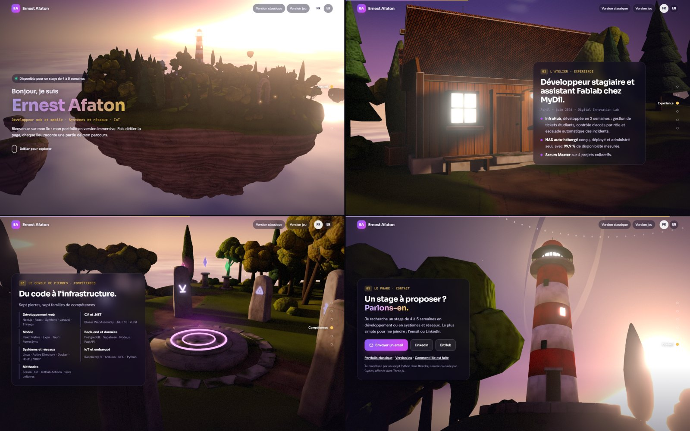
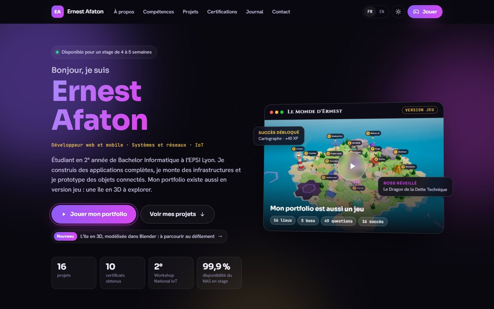
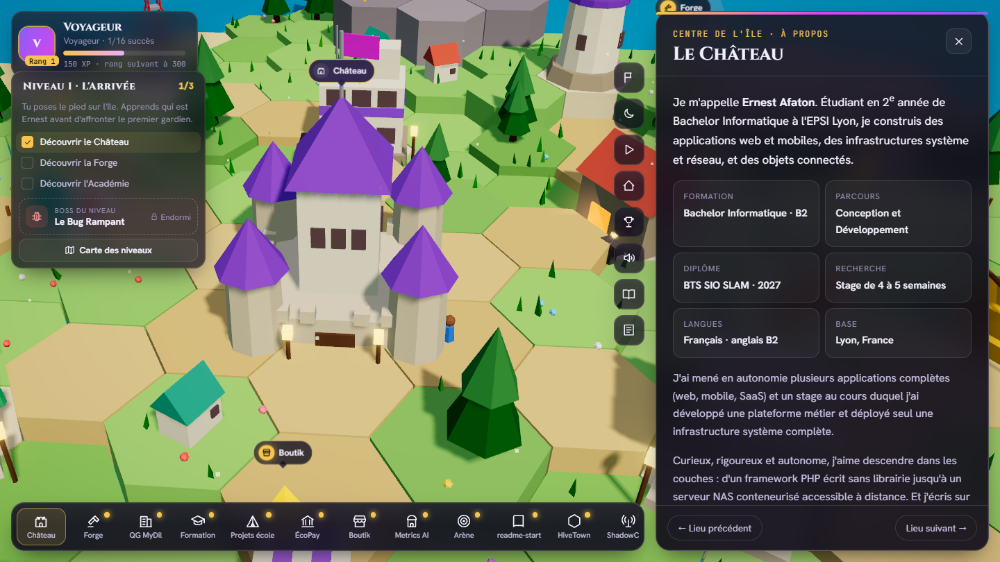

# Le Monde d'Ernest

[](https://github.com/ernestjesutinafaton-maker/ernestjesutinafaton-maker.github.io/actions/workflows/deploy.yml)

Portfolio et blog d'Ernest Afaton, en trois versions :

- **le portfolio classique**, en page d'accueil : tout le parcours sur une seule page (projets, compétences, formation, certifications) ;
- **la version immersive**, sous `/3d/` : une île au coucher du soleil, modélisée et éclairée dans **Blender**,
  que l'on parcourt en faisant défiler la page. Chaque lieu de l'île est un chapitre du parcours ;
- **la version jeu**, sous `/jeu/` : une île en 3D où chaque bâtiment est une section. Le visiteur gagne de l'XP,
  monte de rang, affronte des boss et débloque des succès en explorant et en lisant le Journal (blog).

Les trois versions existent en français et en anglais (bouton FR / EN, ou `?lang=en` dans l'adresse).

**Portfolio :** https://ernestjesutinafaton-maker.github.io · **Île en 3D :** https://ernestjesutinafaton-maker.github.io/3d/ · **Jeu :** https://ernestjesutinafaton-maker.github.io/jeu/

### L'île en 3D (`/3d/`)

[](https://ernestjesutinafaton-maker.github.io/3d/)

### Le portfolio classique et la version jeu

| Portfolio classique (`/`) | Version jeu (`/jeu/`) |
|---|---|
| [](https://ernestjesutinafaton-maker.github.io/) | [](https://ernestjesutinafaton-maker.github.io/jeu/) |

> **In English:** my portfolio and blog. The home page is a classic one-page resume; the immersive version
> ([/3d/](https://ernestjesutinafaton-maker.github.io/3d/?lang=en)) is a sunset island modeled by a Python script in
> **Blender**, with lighting baked by Cycles and rendered by Three.js as you scroll; the game version is a 3D island
> where every building is a part of my journey, with 5 bosses to fight in turn-based battles where questions about my
> projects are your attacks. All three are available in English. Built with **C# (Blazor WebAssembly, .NET 10)**,
> **Blender**, **Three.js**, xUnit and GitHub Actions. **[Portfolio](https://ernestjesutinafaton-maker.github.io/?lang=en)** ·
> **[3D island](https://ernestjesutinafaton-maker.github.io/3d/?lang=en)** · **[Play it](https://ernestjesutinafaton-maker.github.io/jeu/?lang=en)**
>
> ⭐ Si le projet te plaît, une étoile sur GitHub m'aide beaucoup. If you like it, a star really helps!

## Technologies

| Partie | Technologie |
|---|---|
| Page d'accueil | HTML, CSS et JavaScript, sans framework : s'affiche tout de suite, imprimable |
| Version immersive | **Blender 5** (scène générée par un script Python, lumière cuite avec Cycles), glTF compressé avec Draco, Three.js |
| Version jeu | **C#** avec **Blazor WebAssembly** (.NET 10) : le C# s'exécute dans le navigateur |
| Règles du jeu | Bibliothèque C# testée : moteur de combat, boss et questions |
| Île en 3D | Three.js (WebGL), pilotée depuis le C# : ombres, bloom, contours, particules, ciel jour/nuit |
| Sons | Web Audio API : tous les sons sont synthétisés, aucun fichier audio |
| Blog | Articles en Markdown, transformés en HTML par Markdig |
| Générateur | Programme console C# : liste des articles, flux RSS, plan du site |
| Tests | xUnit |
| Hébergement | GitHub Pages, déployé par GitHub Actions |

## Organisation du dépôt

```
src/ErnestWorld/              Le site
  wwwroot/index.html          Page d'accueil : le portfolio classique (texte français dans la page)
  wwwroot/site/               Style et script de la page d'accueil (traduction anglaise dans portfolio.js)
  wwwroot/3d/                 Version immersive : page, moteur Three.js (ile3d.js), modèle et textures (assets/)
  wwwroot/jeu/index.html      Page qui lance la version jeu (Blazor WebAssembly)
  Components/World/           L'île : interface de jeu, quêtes, succès, visite guidée
  Components/Places/          Le contenu de chaque bâtiment (un fichier par lieu)
  Components/Blog/            Cartes d'articles
  Components/Shared/          Petits composants réutilisables (newsletter, liens…)
  Pages/                      Le Journal et la page d'article
  Data/                       La carte de l'île, les icônes, les règles du jeu (XP, niveaux, succès)
  Services/                   Progression, blog, newsletter, pont vers la 3D
  wwwroot/js/world.js         Le moteur 3D (Three.js)
  wwwroot/posts/              Les articles du Journal (Markdown)
  wwwroot/classique/          Redirige les anciens liens vers la page d'accueil
  Services/LanguageService.cs Langue de la version jeu (français ou anglais)
src/ErnestWorld.Content/      Lecture des articles (en-tête, temps de lecture), partagée
src/ErnestWorld.Game/         Règles du jeu : moteur de combat (Battle), boss et questions (Bestiary)
tools/ErnestWorld.Generator/  Générateur du Journal
tools/blender/ile.py          Scène Blender de la version immersive (modélisation, cuisson, export)
tests/                        Tests unitaires (articles, combats, questions)
```

## Le jeu

- **Campagne en 5 niveaux** (`Data/Campaign.cs`) : chaque niveau demande de découvrir des lieux
  (ou de lire des articles), puis réveille son **boss**. Les lieux restent toujours visitables.
- **Boss** (`src/ErnestWorld.Game/Bestiary.cs`) : le Bug Rampant, l'Hydre Hors-Ligne, le Golem du Réseau,
  le Kraken du Code Legacy et le Dragon de la Dette Technique (boss final en deux phases).
- **Combats au tour par tour** (`Battle.cs`) : une bonne réponse frappe le boss, une mauvaise coûte un cœur.
  Les combos augmentent les dégâts (×1,5 puis ×2 en coup critique), les indices retirent deux mauvaises réponses.
- **Rangs** : l'XP fait monter de rang, et un rang élevé donne plus de cœurs et d'indices au combat.
- **Succès**, visite guidée, mode nuit, mini-carte, sons et ambiance (coupables d'un bouton).

Liens directs : `/jeu/?lieu=forge` ouvre un lieu, `/jeu/?combat=golem` lance un combat (si le boss est réveillé),
`?lang=en` affiche le site en anglais.

### Traductions

Chaque texte de la version jeu existe en deux langues. Dans les composants, `@T("texte", "text")` choisit la bonne version ;
dans les données (lieux, niveaux, succès, boss, questions), le type `Txt` porte les deux langues : `T("Le Château", "The Castle")`.
Les articles du Journal restent en français (une note le signale en anglais).

### Ajouter une question à un boss

Dans `Bestiary.cs`, ajouter une ligne `new(T("Question ?", "Question?"), T("Bonne réponse", "Right answer"), [T("Faux 1", "Wrong 1"), …], T("Explication.", "Explanation."))`.
Le paramètre `HintPlace` indique le lieu de l'île où trouver la réponse, `Code` affiche un extrait de code,
et `Phase: 2` réserve la question à la phase enragée du boss final. Les tests vérifient que chaque question est bien formée.

## L'île en 3D (Blender)

La version immersive (`/3d/`) suit la méthode des sites 3D « réalistes » : on ne demande pas au navigateur de calculer
l'éclairage, on le **cuit** à l'avance.

1. `tools/blender/ile.py` construit l'île dans Blender avec Python :
   - le relief, la falaise en blocs et en colonnes, les racines qui pendent, des cristaux lumineux dans la roche ;
   - le chemin et ses lanternes, un étang, le ruisseau et sa cascade qui tombe dans les nuages ;
   - l'arche couverte de lierre, l'atelier, le cercle de menhirs, les socles des cristaux, le phare ;
   - une centaine d'arbres (chênes, sapins, cyprès) et de buissons fleuris, faits de **cartes de feuilles** : des rectangles
     découpés par une texture de feuilles que le script peint lui-même (`feuilles_*.webp`), comme dans les jeux vidéo ;
   - le trajet de la caméra (objets vides `cam_XX` / `cible_XX`, avec leur champ de vision).
2. Cycles calcule la lumière du coucher de soleil (soleil, ciel, ombres douces, lumière qui rebondit, fenêtres et lanternes
   allumées) et l'enregistre dans quatre **atlas** (terrain, roche, bâtiments, végétation), en WebP de 1024 à 4096 pixels.
3. Le modèle part en glTF compressé avec Draco (`ile.glb`).
4. Dans le navigateur, `wwwroot/3d/ile3d.js` affiche chaque maillage avec sa texture cuite, sans calcul de lumière : la scène
   ressemble au rendu de Blender et reste fluide sur téléphone. Three.js ajoute ce qui vit :
   - les feuilles et l'herbe qui bougent dans le vent. L'herbe prend sa couleur dans l'atlas du terrain, donc aussi ses ombres ;
   - l'eau qui reflète le ciel, la cascade et sa brume, la mer de nuages ;
   - une brume dorée du côté du soleil, des rayons de lumière ;
   - le faisceau du phare, les cristaux, les glyphes, les lucioles, la fumée et les oiseaux.

   Le défilement de la page fait avancer la caméra d'un chapitre à l'autre, jusqu'à une vue d'ensemble pour finir.

Le site charge d'abord les atlas en 1024 pixels, puis les remplace par la haute définition (2048 sur mobile, 4096 sur ordinateur).
Sans WebGL, la page affiche une image de l'île rendue par Blender (`assets/affiche.webp`) et tout le texte reste lisible.

Régénérer l'île (il faut [Blender](https://www.blender.org/download/) 5.1 ; la cuisson prend une vingtaine de minutes avec une carte graphique) :

```bash
blender -b --factory-startup --python tools/blender/ile.py                                # construit, cuit et exporte
blender -b --factory-startup --python tools/blender/ile.py -- --etapes construire,apercu --chapitre tous   # images d'aperçu
blender -b --factory-startup --python tools/blender/ile.py -- --rapide                    # cuisson rapide pour essayer
```

Pour retoucher l'île à la main : ouvrir `tools/blender/out/ile.blend` dans Blender, modifier (déplacer un arbre, ajouter un
objet dans une collection `atlas_…`, déplacer une clé de caméra), enregistrer, puis relancer seulement la cuisson :

```bash
blender -b tools/blender/out/ile.blend --python tools/blender/ile.py -- --etapes cuire
blender -b tools/blender/out/ile_cuite.blend --python tools/blender/ile.py -- --etapes exporter   # réexporter sans recuire
```

La cuisson n'est pas lancée par GitHub Actions (pas de Blender ni de carte graphique sur le serveur) : le modèle et les
textures générés sont enregistrés dans le dépôt, sous `wwwroot/3d/assets/`.

## Lancer le site en local

Il faut le [SDK .NET 10](https://dotnet.microsoft.com/download).

```bash
dotnet run --project tools/ErnestWorld.Generator   # met à jour la liste des articles
dotnet run --project src/ErnestWorld               # lance le site, puis ouvrir l'adresse affichée
```

La page d'accueil s'ouvre à l'adresse affichée ; la version jeu est sous `/jeu/` et l'île en 3D sous `/3d/`.
En local, le serveur de .NET renvoie la page d'accueil pour toute adresse qu'il ne connaît pas (`/jeu/`, `/journal`…) :
un petit script en tête de `index.html` ouvre alors la bonne page, comme `404.html` le fait sur GitHub Pages.

Tests : `dotnet test`

## Écrire un article

1. Copier `src/ErnestWorld/wwwroot/posts/_modele.md` dans le même dossier, par exemple sous le nom `mon-article.md`.
   Le nom du fichier devient l'adresse `/journal/mon-article` (minuscules, chiffres et tirets).
2. Remplir l'en-tête (`title` et `date` sont obligatoires) et écrire en Markdown.
3. Mettre `draft: false` (ou supprimer la ligne) pour publier.
4. Lancer le générateur : il vérifie l'article et met à jour la liste, le flux RSS et le plan du site.

Les fichiers qui commencent par `_` et les brouillons (`draft: true`) ne sont jamais publiés.

## Newsletter

Réglée dans `src/ErnestWorld/wwwroot/appsettings.json` :

- **`"Provider": "mailto"`** (par défaut) : le visiteur envoie un email pré-rempli à Ernest. Aucun compte nécessaire.
- **`"Provider": "buttondown"`** : les inscriptions vont dans une vraie liste [Buttondown](https://buttondown.com)
  (gratuit jusqu'à 100 abonnés), avec email de confirmation. Créer un compte, puis renseigner `"ButtondownUsername"`.

## Ajouter une certification sur la page d'accueil

Dans `wwwroot/index.html`, section `#certifications`, copier une carte `<li class="card cert">` et changer son contenu.
Pour la traduction, donner un `data-i18n` à chaque texte et ajouter la version anglaise dans `wwwroot/site/portfolio.js`.

## Ajouter un lieu sur l'île

1. Créer le contenu du panneau dans `Components/Places/` (un fichier `.razor`).
2. L'ajouter à la liste de `Data/Island.cs`, avec sa position sur la grille hexagonale.
3. Ajouter son icône dans `Data/Icons.cs`.
4. Modéliser le bâtiment dans `wwwroot/js/world.js` (objet `BUILD`) et, si besoin, une route dans `ROADS`.

## Déploiement

Chaque envoi sur `main` lance `.github/workflows/deploy.yml` : tests, génération du Journal,
publication, puis mise en ligne sur GitHub Pages.
Dans les réglages du dépôt, *Pages* doit avoir comme source **GitHub Actions**.
